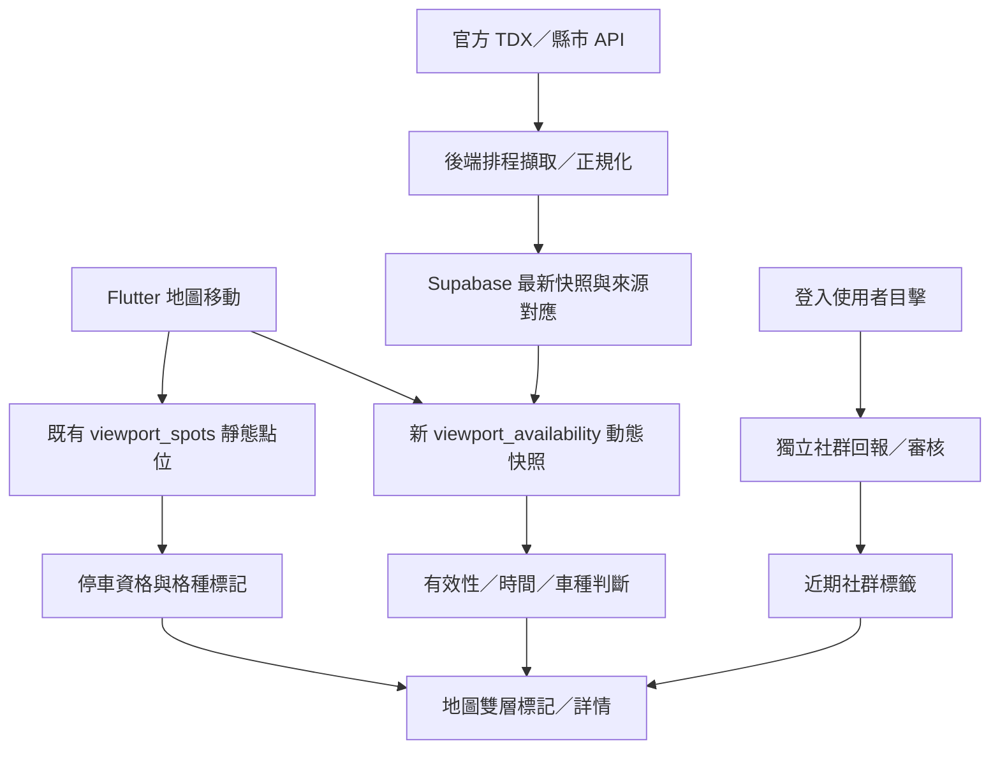

# 機車停車指南 APP｜即時車位與路邊機車格 UI 實作計劃

> **文件狀態**：計畫（尚未實作）。2026-10-26 依程式庫現況審查修訂；P0 的 UI 設計稿見 [designs/2026-10-26-realtime-availability-ui.md](designs/2026-10-26-realtime-availability-ui.md)。  
> **日期**：2026-10-24（原稿）／2026-10-26（修訂）  
> **適用專案**：[smvt1215/motorcycle-parking](https://github.com/smvt1215/motorcycle-parking)  
> **範圍**：普通機車、大型重機；路外停車場、路邊停車路段、具逐格資料的停車格；官方資料及社群回報。

## 0. 決策摘要

1. **「可否合法停放」與「是否有空位」是兩個獨立維度。** 保留現有綠／琥珀／紅／灰色資格標記及形狀、格種角標；新增中性的剩餘格數標籤，不讓兩套狀態共用顏色。
2. **路外停車場**：有可靠且車種明確的官方動態資料時，在標記旁顯示「剩 12」或「已滿」，詳情顯示 `剩餘 / 總格數`、車種、資料來源及更新時間。
3. **路邊機車格**：依資料精度分為「只有靜態總格數」、「路段級即時剩餘」、「逐格即時占用」。沒有官方即時資料時，只顯示「共 N 格／空位未知」，**絕不把總格數寫成剩餘格數**。
4. **社群目擊**：用「8 分鐘前有人回報有空位／停滿」獨立呈現，不能轉換成精確剩餘格數，也不能覆蓋官方資料；沿用專案既有登入、審核及防濫用機制。
5. **分階段交付**：先完成 UI 與資料狀態模型，再稽核官方實際涵蓋，接路外／路段動態資料，最後試辦社群近期狀態與逐格展示。

## 1. 目前專案基線（截至本文件研究）

已閱讀專案 README、`docs/PLAN.md`、`docs/DESIGN.md`、Flutter 資料模型、地圖、詳情面板與資料存取層。現況如下：

- Flutter + Supabase + Google Maps（未設定地圖金鑰時以 OpenStreetMap 預覽）。
- 地圖已有車種資格（可停／有條件／不可停／待確認）、格位分類角標、群聚、搜尋、篩選、選取標記及可拖曳詳情面板。
- 詳情面板約 **42% 預覽高度**，可拉至全高，保留資格理由先於導航操作的資訊順序。
- `ParkingSpot` 已有 `scooterTotal`、`available`、`availabilityUpdatedAt` 欄位；`spot_details.dart` 已有 `availabilitySummary()` 顯示文字，且已把負值視為「暫無即時資訊」。
- **後端只有 `community_spots` 有 `available` 欄位**；`official_heavy_spots` 沒有任何剩餘數欄位，`official_viewport_spots` 也只回傳 `scooter_total`。官方即時資料需要新的儲存位置，不能沿用官方點表。
- 2026-10-26 起（#108）`community_spots`／`official_heavy_spots`／`city_rules` 每次寫入都會 bump `data_versions` 並經 Realtime 推送，所有在線 App 隨即重查目前範圍。**動態快照若寫進這兩張表或掛上同一組觸發器，每分鐘更新一次剩餘數就會讓全部用戶每分鐘重載**；見 7.2。
- 目前程式碼沒有任何剩餘數篩選；3.3 的篩選是全新功能。
- 目前第一版定位為**靜態停車點**；原 TDX 即時層於 2026-10-17 移除，不能把現有欄位等同正式即時服務。
- Supabase 既有 `community_spots` / `official_heavy_spots`、範圍 RPC 與權限機制，但尚須補充完整即時資料的儲存與更新機制。
- `docs/DESIGN.md` 現行寫「路邊格隱藏停車場入口與即時車位欄」。本計畫第 2、4 節改為路邊格顯示「共 N 格／空位未知」，是**刻意變更**，核准後同步 DESIGN.md。
- 現有 `GoogleParkingMap` 會預先繪製 `(資格, 格種角標, 選取狀態)` 的標記圖資；**不要直接把每一個剩餘數字加入全組合預先產圖**。

參考：

- [README.md](https://github.com/smvt1215/motorcycle-parking/blob/main/README.md)
- [docs/PLAN.md](https://github.com/smvt1215/motorcycle-parking/blob/main/docs/PLAN.md)
- [docs/DESIGN.md](https://github.com/smvt1215/motorcycle-parking/blob/main/docs/DESIGN.md)
- [lib/models/parking.dart](https://github.com/smvt1215/motorcycle-parking/blob/main/lib/models/parking.dart)
- [lib/features/map/map_page.dart](https://github.com/smvt1215/motorcycle-parking/blob/main/lib/features/map/map_page.dart)
- [lib/features/map/map_legend.dart](https://github.com/smvt1215/motorcycle-parking/blob/main/lib/features/map/map_legend.dart)
- [lib/features/map/google_parking_map.dart](https://github.com/smvt1215/motorcycle-parking/blob/main/lib/features/map/google_parking_map.dart)
- [lib/features/map/spot_sheet.dart](https://github.com/smvt1215/motorcycle-parking/blob/main/lib/features/map/spot_sheet.dart)
- [lib/features/map/spot_details.dart](https://github.com/smvt1215/motorcycle-parking/blob/main/lib/features/map/spot_details.dart)
- [lib/data/app_store.dart](https://github.com/smvt1215/motorcycle-parking/blob/main/lib/data/app_store.dart)
- [lib/data/repositories.dart](https://github.com/smvt1215/motorcycle-parking/blob/main/lib/data/repositories.dart)

## 2. 資料類型與顯示準則

| 資料精度 | 類型 | 必備條件 | 地圖顯示 | 詳情顯示 |
|---|---|---|---|---|
| 靜態 | 路外停車場 | 位置、格種、可用容量（若有） | 原標記、`無即時資料`（可按空間省略文字） | `共 80 格` 或 `總格數未提供`、`暫無即時資訊` |
| 靜態 | 路邊路段 | 路段識別、格數／格位類型；座標或線段 | `機車格`、`共 24 格` | `空位未知`、停車時段、費率、可停車種 |
| 動態 | 路外停車場 | 官方停車場 ID、車種、有效更新時間、剩餘數 | `剩 12` / `已滿` | `剩 12 / 共 80`、更新時間、來源 |
| 動態 | 路邊路段 | 官方路段 ID、車種、路段範圍、有效時間 | `路段剩 5` | 路段範圍、剩餘／總格數、有效時間 |
| 動態 | 單一格位 | 官方格位 ID、精確位置、占用狀態、有效時間 | 放大後 `空位` / `占用` | 格位型態、使用限制、最後回報時間 |
| 社群 | 近期目擊 | 身分／防濫用、回報時間、路段或點位 | 小型「近期回報」提示；不得宣稱官方即時 | `8 分鐘前有人回報有空位`（非空位保證） |

### 必須遵守的語意

- `available = 0` → **已滿**，不能顯示「未知」。
- `available = null`、缺少目標車種欄位、官方定義的無資料特殊值（例如某些來源的 `-9`）→ **無即時資料／該車種無資料**；不得默認為 0。
- 剩餘格數不得大於有效總容量。若衝突，標記異常且不顯示數字，留下供稽核的原始資料。
- **普通機車餘位 ≠ 大型重機餘位**。來源只提供一般機車數時，不得把它拿來表示重機專用／汽車格剩餘。
- **可停的法律資格與有位是獨立狀態**：即使來源回傳剩餘 20 格，對目前車種不可停仍必須維持不可停標記。
- 官方來源有停用／封閉訊號時，顯示「暫停營運」，不能當作「已滿」。
- 路段只有一個代表點時不能畫出臆測的精確路段線或逐格位置；需有可靠幾何範圍才能畫路段線。

## 3. 地圖 UI 規格

### 3.1 兩層標記（預設）

```text
[綠色資格 P 圖示] [剩 12]
[琥珀條件圖示]   [剩 2]
[綠色資格 P 圖示] [已滿]
[灰色待確認]     [無資料]
```

- 左側沿用現有 `SpotMarker` 的顏色、形狀、車種限制與格位分類角標。
- 右側中性底色膠囊顯示**官方有效的**剩餘數，避免與資格顏色衝突。
- 不以呼吸光效、跑馬燈或持續閃爍提示即時狀態；淡入／數字轉換須尊重減少動態效果設定。
- 選取標記仍使用現有放大與藍色描邊，數量標籤跟著更新，但保持固定地圖錨點。
- 沒有即時資料時可以只保留原標記，詳情中一定明示「空位未知／暫無即時資訊」。
- **重機剩餘數膠囊**（2026-10-26 決定，第一批）：只在有有效重機值的場站顯示；無值時不顯示，也不顯示 0。
- **汽車格剩餘膠囊（重機停汽車格）**（2026-10-26 決定，第一批）：目前車種為大型重機，且場站資料已確認重機可停汽車格（場站 `parking_access` 或分區 `access` 為 `heavyCar`）時，另外顯示「汽車格 剩 N」，詳情寫「與汽車共用」。來源為臺北市停管處汽車剩餘，新鮮度規則與機車相同（`-9` 無資料、剩餘大於容量算異常）；與重機專用剩餘數分開、用中性樣式，不能算成重機有位，也不讓「目前有位」篩選把它當成重機空位；費率照汽車。未確認的場站不顯示。staging 目前符合的點數為 0，缺的資料見 [availability-coverage.md §9.1](availability-coverage.md#91-重機停汽車格staging-臺北符合條件的點)。路邊汽車格（重機可停）圖層另案設計（issue #127）。

### 3.2 地圖縮放與路邊格

以下 zoom 為**待實測初值**，須在 iOS／Android／Web 及不同密度地區調整：

| 縮放層級 | 路外停車場 | 路邊格 |
|---|---|---|
| `zoom < 15` | 維持既有群聚；不將群聚點數誤當空位數 | 群聚停車點／路段，必要時只顯示路段數 |
| `15 ≤ zoom < 18` | 單點：資格標記 + 有效剩餘標籤 | 具有路段幾何時：路段線 + `路段剩 5`；純靜態則 `共 24 格` |
| `zoom ≥ 18` | 單點顯示 | **僅在有真實逐格座標與狀態時**展開逐格標記；否則維持路段摘要 |

- 原有群聚數字一律表示「停車點／路段數」，不顯示為格位剩餘合計。
- 路邊路段線應區別「可停／條件／不可停」，剩餘資訊在中性標籤中顯示。
- 地圖擁擠時優先保留法律資格，依序隱藏容量／最近目擊的次要標籤；不以縮得看不清的字硬塞資訊。
- 有多個格種區域時，依官方資料顯示分區；無分區數量時不得杜撰各車種餘位。

### 3.3 篩選與搜尋

新增篩選但不改變現有車種選擇與可停判定（目前程式碼沒有剩餘數篩選，以下皆為新功能）：

- `有即時資訊`：只包含資料新鮮、車種匹配且有有效狀態的路外場或路段，**含已滿**。
- `目前有位`：只包含資料新鮮、車種匹配、剩餘大於 0、且對目前車種符合停放條件的點；有條件可停時仍保留警示說明。
- `路外 / 路邊`：資料覆蓋足夠後，提供位置類型切換；不需要直接新增過多篩選 pill，可收進格位類型選單。
- 空結果顯示原因及「清除篩選」；不能將資料未知理解成 0 格。
- 被「目前有位」排除的點在地圖上改為**灰色小圓點**（無圖示），不用淡灰的完整標記；完整標記變淡保留給車友回報已不存在（`reported_gone`），兩者需可區分（2026-10-26 使用者決定，見[遊戲化研究 §10 第 9 點](CONTRIBUTION_TIERS_FEASIBILITY.md#10-拍板決策2026-10-26-全部決定)）。
- 搜尋和地圖標記沿用同一組篩選結果，避免列表與圖面不一致。

## 4. 車位詳情面板規格

沿用現有 42% 預覽／全高 bottom sheet。資訊順序：

1. 名稱、場地／路邊類型、行政區／距離、收藏／分享／關閉。
2. **目前車種資格與理由**（保留，不能被即時車位卡片蓋掉）。
3. **即時車位摘要**（若有官方可信資料）：`剩 12 / 共 80 格` + `普通機車` + `17:00 更新` + `官方來源`。
4. 若沒有即時資料：`共 18 格（靜態資料）`、`空位未知`，並顯示官方靜態資料的更新日期（如有）。
5. 路邊格額外顯示：路段範圍、道路側別（資料有才顯示）、收費時段、禁停／限時規定及現場指引。
6. 導航／修改建議／現場目擊回報入口（目擊回報屬新功能，不能冒充既有回報流程已支援）。
7. 全高時展示來源明細、車種分區、更新時間、資料狀態、照片與備註。

```text
┌──────────────────────────────┐
│ 南京東路三段 · 路邊機車格       │
│ 普通機車可停（依現場標線規則）  │
├──────────────────────────────┤
│ 共 18 格                      │
│ 空位未知 · 目前無官方動態資料  │
│                              │
│ 騎士回報：8 分鐘前「有空位」   │
│ ※ 回報非即時保證              │
│                              │
│ [導航]          [回報現場狀況] │
└──────────────────────────────┘
```

`共 18 格` 是容量，並非剩餘數；此線框為假資料範例。

## 5. 時效性、異常與來源標示

### 5.1 官方即時狀態機

建議以來源宣告的 `expected_update_interval` 決定逾時門檻，而不是對所有縣市固定 3 分鐘：

- **新鮮 `fresh`**：在來源校準的允許時窗內；可顯示數字及更新時間。
- **延遲 `delayed`**：稍超過新鮮時窗，仍可顯示最後一筆數字，但強制加註「更新延遲」，不可套用「目前有位」篩選。
- **過期 `stale`**：超過最大時效；主標記退回「資料過期／空位未知」，歷史值最多放在詳細資訊並標清最後時間。
- **無資料 `unavailable`**：無車種對應資訊或無有效回應；不使用 0 代替。
- **暫停 `suspended`**：來源明確標示場站停止服務；與已滿分開。
- **資料異常 `invalid`**：負值特殊碼、總數矛盾、未來時間戳或資料不合理；顯示未知並記錄診斷事件。

**僅供首次試驗的門檻**：若來源規定每 1 分鐘更新，可先測試 0–3 分鐘新鮮、3–10 分鐘延遲、超過 10 分鐘過期；若來源每 10 分鐘更新，必須按來源調整。正式值以稽核及服務條款核定。

### 5.2 社群目擊狀態

- 回報文案：`剛看到有空位`、`現場停滿`、`無法停車／施工中`（第三項可進既有修改建議審核流程）。
- 提議有效性：**0–15 分鐘近期**；**15–30 分鐘較舊**；**超過 30 分鐘不放在地圖主標記**，僅視政策保留歷史事件。均為待驗證 UX 假設。
- 多人互相衝突的回報顯示 `近期回報不一致`；不投票出精確空位數。
- 不接受同一帳號／裝置高頻洗版；儲存時間、來源及有限期間的回報紀錄；禁止把經審核的存在狀態誤判成即時空位。
- 社群回報須有明確 `使用者目擊` 標籤；不可產生 `官方即時` 文案。
- 身分、節流與審核沿用既有機制：[COMMUNITY_VERIFICATION_PLAN.md](COMMUNITY_VERIFICATION_PLAN.md) 的核實分層與 `202610240010_vote_safety.sql` 的投票防濫用；不另起一套。

## 6. 官方資料接入與稽核

### 6.1 候選來源（先稽核，後介接）

- TDX 路外停車場、路邊停車路段及逐格動態資料介面：確認**各縣市有無普通機車／大型重機欄位**、授權、更新週期、ID 穩定性。
- 縣市政府自有開放資料：包含臺北市路邊格位圖資等**靜態**資料；其他路外／路段動態資料須以實際 API 欄位及官方文件判斷，不得以資料集名稱假設有機車即時資料。
- 先測臺北、新北、臺中、桃園、高雄等有代表性的場站及路段，並涵蓋非六都地區一組負例。
- `docs/PLAN.md`「資料來源」一節已整理第二層來源，稽核從該表出發，不重新列舉。2026-10-26 稽核已更正其中的臺中描述：路外資料集只有機車燈號、路邊資料集沒有機車格種，臺中的機車格數只能從 TDX 取得；臺北停管處 XML V2 與臺南 Parkweb、新竹 hispark 有機車剩餘（見 [availability-coverage.md](availability-coverage.md)）。
- **稽核必須在本機或已放行網域的環境執行**：PLAN.md 記錄開發用雲端環境對 `tdx.transportdata.tw`、`data.taipei`、`data.gov.tw` 都是 403。

**重要**：API 端點、資料授權、實際覆蓋和機車車種欄位需重新查證，本計劃不宣稱任何縣市已提供完整路邊機車即時格數。

### 6.2 稽核輸出 `docs/availability-coverage.md`

取代 PLAN.md「Phase 0：TDX 資料完整性稽核」原規劃的 `docs/tdx-coverage.md`，只留一份。按縣市、來源、資料類型列出：

- 官方 API 名稱、URL、授權與配額、名義更新週期、實際資料更新時間分布。
- 靜態場站／路段總量、其中有官方即時資料筆數、**包含普通機車與大型重機欄位的各自占比**。
- 官方識別碼能否對上目前 `ParkingSpot.id`；座標／路段幾何品質；同一來源與跨來源重複情形。
- `-9` 等特殊值、暫停營運碼、缺欄位、延遲、資料倒退與瞬間跳值處理。
- 每縣市至少抽查數個現場或官方頁面可交叉比對的停車場／路段。
- 稽核後決定哪些來源能啟用「目前有位」功能，哪些**只能顯示靜態容量**。

## 7. Flutter + Supabase 技術方案

### 7.1 動靜態模型分離

不讓每分鐘更新的剩餘數重寫整筆 `ParkingSpot`。推薦：

```dart
// 設計草案；非已合併程式碼
class AvailabilitySnapshot {
  final String spotId;
  final String? sourceFacilityId;
  final String vehicleKind; // scooter | heavy | car | unknown
  final String granularity; // facility | segment | space
  final int? total;
  final int? available;
  final String? occupancy; // free | occupied | out_of_service
  final DateTime sourceUpdatedAt;
  final DateTime fetchedAt;
  final String provider;
  final String status; // fresh | delayed | stale | unavailable | suspended | invalid
}
```

- 動態資料以 `spot_id + vehicle_kind + granularity + (segment/space id)` 做對應，避免不同車種共用數字。
- 區分 `sourceUpdatedAt`（來源實際生成時間）與 `fetchedAt`（後端抓取時間）；判斷新鮮度只能依合格來源時間，不能靠剛抓到資料假裝最新。
- 來源的原始負值碼在 adapter 層正規化，並保留稽核所需原始碼；前端只接收有效的 `available >= 0` 或 `null`。
- 已有 `ParkingSpot.available` 與 `availabilityUpdatedAt` 作為**舊版相容欄位**，新的顯示與篩選以獨立 `AvailabilitySnapshot` 為權威，避免把長期保存的舊收藏當即時資訊。

### 7.2 後端建議

新建 migration（檔名依實際版本序號決定）包含：

- `availability_sources`：來源設定、授權註記、更新週期、啟用縣市、可用車種。
- `availability_mappings`：來源場站／路段／格位 ID 對應既有 `spot_id`，含匹配信心、人工審核狀態；低信心不自動合併。
- `parking_availability_latest`：每一識別單位的最新有效快照、來源時間、擷取時間、狀態；最小必要索引與唯一本鍵。**獨立於 `community_spots`／`official_heavy_spots`，且不得掛 `bump_data_version('spots')` 觸發器**，否則每次快照更新都會讓所有在線 App 重查整個範圍。若要推送，另開 `data_versions` 的 `availability` 鍵或獨立 Realtime 頻道，只推可視範圍的快照變更。
- `parking_availability_history`：**可選**短期診斷歷史；需設定保留期限、容量預算與刪除排程。
- `viewport_availability` RPC 或 Edge Function：只取目前可視範圍中所需 spot ID 的動態資料，驗證授權，僅回傳公開的展示欄位。
- 定期擷取 job（Supabase 排程或受控外部工作者）：依來源更新周期擷取、ETag／快取與退避重試、錯誤隔離；金鑰保留後端、服務角色限最小權限、RLS 不允許一般使用者寫入官方快照。

### 7.3 App 資料流



### 7.4 前端效能與狀態

- 保留 `AppStore.refresh()` 的靜態範圍載入；另建動態 `AvailabilityRepository` 與狀態快取，**不要為數量更新反覆重載所有靜態點位**。
- 僅地圖可見且資料來源確有動態服務時更新；切到背景、其他分頁或未開啟地圖時停止積極輪詢；回到前景先比較快取時效再補拉。
- 初始可用服務端快取 + 約 60 秒前端刷新節奏作實測起點，**實際依官方更新間隔、授權配額、成本與功耗調整**；錯誤採指數退避。既有 `DataUpdates` 已有 Realtime 訂閱與回前景比對版本的模式，可評估以獨立頻道推送快照版本取代輪詢，但不得共用 `spots` 鍵。
- 目前地圖已有 viewport generation 防舊回應覆蓋；動態資料請求也要具備取消／版本序號，避免前一個地圖範圍的回傳蓋掉新資料。
- FlutterMap：可在 `SpotMarker` 外包可選數量 pill；Google Maps：數字需要動態圖資或其他可靠顯示層，針對可視點位增量繪製並快取，**不要對每個數字 × 每種資格 × 每種格種預先全排列建圖**。
- 目前 Google Maps 選取點會脫離群聚並上層呈現；擴充後仍需保證選取點及詳情即時更新時不閃爍、跳動或被群聚蓋住。
- 路段線圖層應在可靠 geometry 與效能測試後啟用；沒有 geometry 時以官方代表點顯示並明示精度限制。

## 8. 影響檔案及工作分解

| 檔案／目錄 | 修改內容 |
|---|---|
| `lib/models/parking.dart` | 新增獨立 availability model 或新增 `lib/models/availability.dart`；舊資料相容性測試 |
| `lib/data/repositories.dart` | 增加 viewport 動態查詢、來源時間／車種欄位解析 |
| `lib/data/app_store.dart` | 動靜態獨立載入、快取、刷新、篩選、錯誤狀態、避免 stale 回應競態 |
| `lib/features/map/map_legend.dart` | 保留資格標記；增加數字 pill、資料狀態說明、無障礙文字 |
| `lib/features/map/google_parking_map.dart` | 即時數字圖資／增量更新／快取、群聚與選取點測試 |
| `lib/features/map/map_page.dart` | 縮放行為、路段呈現、`有即時資訊`／`目前有位` 篩選、刷新提示 |
| `lib/features/map/spot_sheet.dart` | 半高預覽即時摘要、路段總格數、最後更新、來源；不干擾資格理由 |
| `lib/features/map/spot_details.dart` | 明確格式化 `0`、缺值、過期、來源／車種分隔；舊版相容 |
| `lib/features/report/` | 後期新增社群近期空位目擊工作流，不直接改動現有「點位不存在」回報語意 |
| `supabase/migrations/` | 新的來源、映射、快照／索引／權限／查詢 migration |
| `supabase/functions/`／`tool/` | 官方 adapter、資料驗證、排程更新與測試（具體位置按部署選擇） |
| `test/`、`integration_test/` | 資料時效、車種對應、地圖圖例、詳情、跨平台交互與性能測試 |
| `docs/DESIGN.md`、`docs/PLAN.md` | 核准後同步決策、資料覆蓋與 UI 規範，不移除原本靜態資料限制說明直到功能正式可用 |

## 9. 里程碑、優先級與完成定義

### P0 — UI 原型與資料語意（先做）

範圍限縮為**路外停車場**與四種資料狀態（靜態／新鮮／延遲／未知含已滿、暫停、異常）。路段線與逐格標記的 UI 原型延到 P1 確認真有來源後再做，避免為不存在的資料設計。

- [x] 將「靜態容量／官方剩餘／社群目擊」明確定義為不同資料類型（見 [designs/2026-10-26-realtime-availability-ui.md](designs/2026-10-26-realtime-availability-ui.md)）。
- [x] 完成路外標記、已滿、無資料、延遲、過期、選取與半高 sheet 的 UI 設計稿；路邊靜態與騎士回報列已一併設計，路段線只做示意。
- [ ] 依設計稿實作膠囊、詳情摘要與狀態總表所列文案。
- [ ] 確認篩選規則不會把未知車位排成「已滿」。
- [ ] Android、iOS、Web 的淺色／深色及大字級對照驗證。
- **完成條件**：測試資料下，普通機車與大型重機都能正確辨別法律資格、總容量、空位數及來源。

### P1 — 官方來源覆蓋稽核

- [x] 建立 [availability-coverage.md](availability-coverage.md)，逐來源查明路段／格位動態及機車類型實際覆蓋（2026-10-26）。
- [x] 驗證至少 5 個具代表性縣市與 1 個缺資料負例；核對來源更新時間、ID、特殊值與授權。
- [x] 決定第一批可上線停車場及其顯示閾值：2026-10-26 使用者決定第一批只上臺北市停管處 XML V2（含重機膠囊），臺南、新竹之後再加，其他縣市只顯示靜態容量；臺中、高雄延長抽樣 3 天後再決定是否付費接 TDX（issue #126）。見 [availability-coverage.md §9](availability-coverage.md#9-使用者決定2026-10-26)。
- **完成條件**：每個要啟用動態標籤的來源都有可信資料格式、來源時間與可稽核映射。

### P2 — 官方動態 MVP

- [ ] 新增後端來源表、映射表、最新快照與唯讀 API／RPC；驗證 RLS。
- [ ] 接入臺北市停管處 `TCMSV_allavailable.xml`（V2，P1 第一批）；完成即時摘要及更新時間。重機剩餘數膠囊同批上線，只在有有效重機值的場站顯示，無值時不顯示也不顯示 0；已確認重機可停汽車格的場站另顯示汽車格剩餘膠囊（見 3.1）。
- [ ] 路邊只做**靜態路段**（2026-10-26 使用者決定）：P1 稽核的 8 個縣市都缺少機車路段即時資料（臺北「含機車」路段為汽機車共用格、新北分車種值為佔位 0、其他縣市只有汽車），阻礙記錄於 [availability-coverage.md §4.3](availability-coverage.md#43-路邊路段與逐格v1parkingonstreetcitycity)。
- [ ] 實作 `fresh/delayed/stale/unavailable/invalid` 行為、地圖增量更新與篩選。
- **完成條件**：官方來源延遲、斷訊、0 格、缺值、跨車種都可正確顯示，沒有假即時。

### P3 — 社群近期目擊（須另核准資料治理）

- [ ] 設計登入後回報、反濫用、刪除／申訴、衝突呈現與保留期限。
- [ ] 與原有「修改建議／點位不存在」分流；社群資料不得覆蓋官方快照。
- [ ] 用小規模實地測試確認 15/30 分鐘提示是否容易被誤解。
- **完成條件**：使用者能清楚說明「有人看到有位」不是官方已確認的剩餘格數。

### P4 — 逐格精細化（條件式）

- [ ] 只對實際有逐格 ID、座標、更新時間與占用狀態的區域啟用。
- [ ] 壓力測試大量標記、Google Maps 產圖、群聚及電量／網路消耗。
- **完成條件**：不存在用路段總數偽造逐格座標、狀態或車位圖示的情況。

## 10. 必要驗收測試

### 邏輯與資料

- [ ] `available = 0` 顯示「已滿」。
- [ ] `available = null`、`-9` 或缺少該車種欄位顯示「無即時資料」，不顯示「已滿」。
- [ ] 靜態 `total = 24`、無官方即時欄位時只顯示「共 24 格／空位未知」。
- [ ] 一般機車剩餘 12 格、大重剩餘缺值時，切換至大型重機只顯示未知，法律資格照舊判斷。
- [ ] 已經 30 分鐘沒有來源更新的資料，不能因剛剛成功輪詢而重新標為新鮮。
- [ ] `available > total`、異常負值、未來時間與資料亂序不直接進入 UI。
- [ ] 兩個官方來源對同一點回報衝突時，不自行加總；採核准的來源優先順序／人工映射。
- [ ] 社群目擊永遠不產生「剩 N 格」官方標籤。

### 地圖與互動

- [ ] 範圍拖曳時舊請求不覆蓋新結果；所選停車點不被群聚吞沒。
- [ ] 群聚「12」永遠代表 12 個點／路段，不是 12 個剩餘車位。
- [ ] 逐格資料缺少精確位置時不能展開逐格占用標記。
- [ ] 篩選「目前有位」排除過期、未知、0 格、車種不匹配與不可停；無結果可一鍵清除。
- [ ] 地圖與清單使用相同篩選和即時資料版本。
- [ ] 官方動態資料更新時，已開啟的詳情面板不關閉、不閃爍，會更新時間與數值。

### 品質與可用性

- [ ] 深／淺色、系統文字放大、VoiceOver／TalkBack、顏色辨識不足情境均能理解狀態。
- [ ] 標記及可點選區符合原專案最小觸控尺寸規範；控制不蓋住 Google 標誌／底部分頁。
- [ ] 背景時不高頻輪詢；服務錯誤有退避與可讀提示；無網路仍可使用靜態資料。
- [ ] 使用至少 8 位包含普通機車與大型重機的騎士驗證，特別觀察是否將總格數誤認為剩餘格數；此為**提議的研究樣本**，非既有驗證結果。

## 11. 風險與待決事項

| 風險 | 對策 |
|---|---|
| 全國路邊機車動態涵蓋不足 | 不阻塞靜態路段 UI；只在可核實來源啟用官方即時 |
| 官方資料把汽車格數誤當機車格數 | 車種別 schema 與來源欄位白名單；缺值顯示未知 |
| 多個來源對同一停車場／路段難以配對 | 穩定來源 ID + 人工審核映射；不靠距離直接合併 |
| 來源時間不可信／回傳快取舊值 | 區分 `sourceUpdatedAt` 與 `fetchedAt`，按來源週期校準 |
| Google Maps 標記數字造成重繪負擔 | 僅可視範圍增量產圖、快取、減少遠距標籤 |
| 社群刷票與造假 | 登入、節流、審核、限期顯示、標註目擊性質 |
| 個資／位置追蹤 | 不公開回報者精確軌跡；僅保存達成功能所需資料，設定保存期限 |
| 停車判斷涉及法規 | 持續顯示法規／格種資格與現場公告優先；空位不等於合法 |

**已決定（2026-10-26）**：首批只上臺北市停管處、路邊只做靜態路段、重機膠囊第一批就上；各來源 freshness 閾值初值見 [availability-coverage.md §2](availability-coverage.md#2-第一批可上線清單與顯示閾值)。

**決策仍待確認**：臺中、高雄是否付費接 TDX（延長抽樣後決定，issue #126）、是否把路段線視覺化納入第一個正式版本、社群目擊的保存／顯示期限、是否允許未登入者提供匿名目擊（初版建議不允許）。

## 12. 交付物清單

1. 本 UI 計劃與更新後的 `docs/DESIGN.md` / `docs/PLAN.md`。
2. `docs/availability-coverage.md` 官方來源覆蓋與時間品質稽核。
3. 動態資料 schema、migration、RLS／RPC／Edge Function 與 adapter 測試。
4. Flutter 模型、資料層、地圖雙層標記、詳情與篩選。
5. iOS／Android／Web 截圖與測試報告。
6. 實地可用性驗證紀錄，記載資訊誤判與改版結論。

---

> **實作前置提醒**：這份文件是依目前程式庫與 UI 研究提出的**開發計劃**，不是功能已上線聲明；引用的官方動態來源需完成實際 API、車種與授權稽核後才可將「即時」字樣用於產品畫面。
